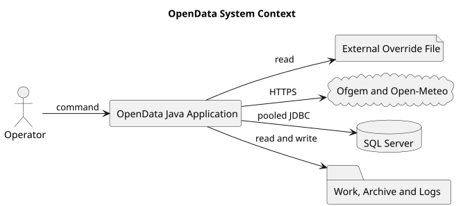

# System Overview

**Document ID:** ARCH-002  
**Version:** 4.0.0  
**Status:** Current application baseline; dependency separation under 4.1.0 review  
**Baseline date:** 10 November 2026  
**Minimum Java version:** 24

---

## System boundary

OpenData is a modular Java application with JavaFX desktop and Commons CLI entry
points. It acquires public datasets over HTTPS or reads local PDF statements,
validates and transforms source data, and optionally writes accepted records
to SQL Server. The database also holds plugin registration, configuration and
run-audit information. Filesystem resources hold logs, downloads, working
files, archives and the external AES key.

With `init=true`, the JavaFX first-run wizard takes precedence over ordinary
CLI/GUI operation. It provisions SQL Server, registers discovered plugins
**disabled**, stores AES-encrypted application credentials and changes `init`
to `false` only on successful completion.

## External participants

| Participant | Interaction |
|---|---|
| Operator or external scheduler | Initialises, administers or executes plugins |
| JavaFX desktop | First-run wizard, registration, status, execution and logs |
| Bootstrap properties file | First-run flag, SQL Server connection details and AES key-file path |
| Ofgem | Historical price-cap publications and spreadsheets |
| Open-Meteo | Historical daily weather JSON API |
| Octopus | Local energy statements and adjustment documents |
| NESO | Historical electricity demand and generation-mix CSV datasets |
| SQL Server | Stores core registration, configuration, execution audit and provider data |
| Filesystem | Holds encrypted bootstrap settings, external AES key, downloads and logs |
| Documentation toolchain | Generates PlantUML illustrations and user/technical manuals |

## Implemented capabilities

- Configurable GUI and CLI startup, including `--gui`, `-g` and no-argument GUI selection;
- three-step first-run wizard with asynchronous provisioning progress;
- SQL Server-based plugin registration and persistent enable/disable state;
- separate Ofgem, OpenMeteo, Octopus, Octopus Adjustment, Electric Demand and
  Electric Supply providers;
- AES-256-GCM credential encryption with key-file location in
  `config/application.properties`;
- bounded parallel execution and per-plugin contextual logging;
- pooled SQL Server JDBC access, plugin-run audit and non-writing dry-run mode.

## Build and runtime boundary

`opendata-api` supplies contracts; `opendata-common` supplies provider-oriented
implementation helpers; `opendata-core` owns CLI/GUI, coordination and SQL
Server services and depends on API only. The `opendata-launcher` module assembles
Core, Common and provider JARs without reversing those dependencies.

## Operational cautions

Dry-run selection may still read registered plugin configuration from SQL Server,
but provider data writes and normal run-audit writes are disabled. Keep AES
keys, SQL administrator passwords and sensitive Octopus documents outside
source control. Live first-run provisioning and Windows GUI operation require
system-level verification beyond the automated Maven build.

::: {.landscape}
{width=22.5cm}
:::
