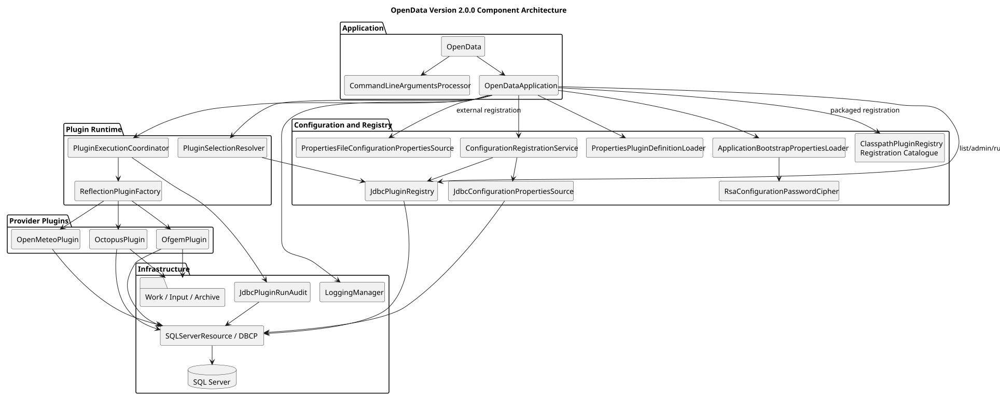

# High-Level Architecture

**Document ID:** ARCH-003  
**Version:** 4.0.0  
**Status:** Current module boundaries as refactored for 4.1.0  
**Baseline date:** 10 November 2026  
**Minimum Java version:** 24

---

OpenData is a modular monolith: one Maven reactor and one application JVM, with
independent provider JARs and explicit compile-time dependency boundaries.

## Reactor modules

| Module | Responsibility | Internal dependencies |
|---|---|---|
| `opendata-api` | Plugin, configuration and database interfaces; shared exception contracts and dependency-free helpers | None |
| `opendata-common` | JDBC helpers, provider-facing download strategies and legacy utility adapters | API |
| `opendata-core` | JavaFX/CLI, first-run setup, plugin registry, execution coordination, SQL Server resources and logging | API only |
| `opendata-plugins` | Aggregator for six providers and electricity/Octopus support projects | API, Common, allowed provider-specific support |
| `opendata-launcher` | Executable application classpath and integration tests requiring packaged plugins | Core, Common, provider implementations |

No Core compilation or Maven runtime dependency points to Common or any
provider plugin. The launcher owns assembly, so Core remains provider-neutral.

## Principal components

| Component | Responsibility |
|---|---|
| `OpenData` | Entry point, `init` switch, GUI/CLI selection and final logging |
| `InitialisationWizard` | SQL Server and AES key setup screens with background progress |
| `InitialisationService` / `SqlServerInitialiser` | Provision schema, login, plugin registration and bootstrap credentials |
| `CommandLineArgumentsProcessor` | Parses CLI operations, validation, help and aliases |
| `JdbcPluginRegistry` | Authoritative registered metadata and enablement |
| `PropertiesPluginDefinitionLoader` | Resolves typed plugin definitions |
| `PluginExecutionCoordinator` | Bounded concurrency, audit, run context and results |
| `ReflectionPluginFactory` | Instantiates plugins named in registered metadata |
| `SQLServerResource` | Database pooling and SQL Server access |
| `opendata-launcher` | Supplies all six provider classes, SQL resources and catalogue entries |

## Deployment and testing

A single launcher classpath carries provider implementations and resources
while application Core depends only on API. Packaged-plugin integration tests
live in the launcher module. Normal `mvn clean verify` requires Java 24 or
later, and Checkstyle and SpotBugs are strict verification gates.

