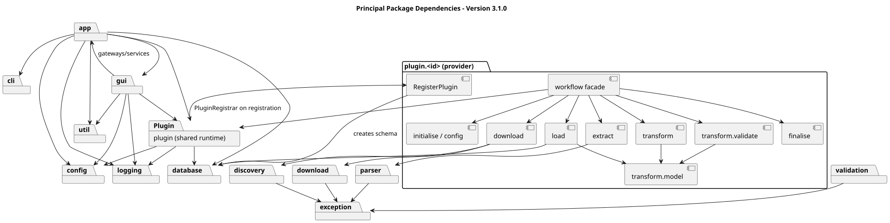

# Dependency Rules

**Document ID:** ARCH-005  
**Version:** 4.0.0  
**Status:** 4.1.0 dependency refactor implemented and verified by Maven tests  
**Baseline date:** 10 November 2026  
**Minimum Java version:** 24

---

## Mandatory module boundaries

| Consumer | Permitted dependencies | Forbidden dependencies |
|---|---|---|
| `opendata-api` | JDK and third-party contracts only | Core, Common, all provider modules |
| `opendata-common` | API and external libraries | Core and all provider modules |
| `opendata-core` | API and external libraries | Common and all provider modules |
| Provider plugins | API, Common, relevant provider-support modules | Core and other provider implementations |
| `opendata-launcher` | Core, Common, API and provider JARs | No reverse dependency into launcher |

Runtime-scoped dependencies are **still dependencies**: they are not permitted
in Core merely because they are declared with `<scope>runtime</scope>`.
Only the launcher may assemble the provider implementation JARs.

The provider-neutral plugin factory loads the implementation class named in
metadata, but it does not import provider implementation types. Provider
registrars are discovered from their conventional class names and packaged
resources using interfaces defined in API.

## Additional code rules

- CLI and JavaFX presentation code delegate database access and execution to
  application services.
- Provider-to-provider implementation references are not permitted.
- Provider-specific SQL and transaction logic belongs in provider-owned load
  repositories; Common supplies reusable helpers where appropriate.
- Dry-run execution must not write provider data, normal run-audit rows or
  final archives.
- Configuration and provider data models should prefer immutable records.
- JDBC resources, streams, workbooks and parsers must have bounded lifetimes.
- Secrets must not appear in logs, committed source or plugin definitions.

## Verification

`opendata-launcher` contains `ModuleBoundariesTest`, which checks POM
declarations, Java imports and the Core module descriptor. Run the full
reactor with strict Checkstyle, SpotBugs and tests:

```powershell
mvn -Dquality.failOnViolation=true clean verify
```

For implementation history and remaining environment checks, see
[4.1.0 module-boundary review](031-module-boundaries-4.1-review.md).


