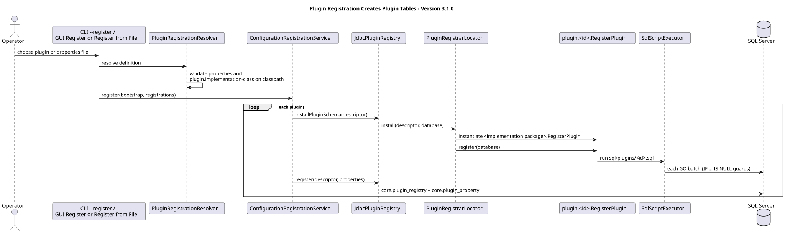
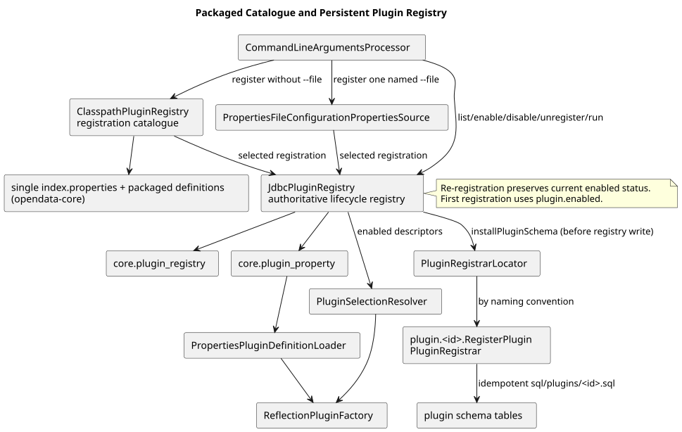

# Plugin Architecture

**Document ID:** ARCH-007  
**Version:** 4.0.0  
**Status:** Current 4.0.0 baseline; 4.1.0 refactoring review  
**Baseline date:** 10 November 2026  
**Minimum Java version:** 24

---

## Contract

A plugin represents one dataset family and implements
`OpenDataPlugin.execute(PluginExecutionContext)`. A `PluginDescriptor` supplies
identity, display name, implementation class and enabled state. A resolved
`PluginDefinition` supplies endpoint and typed property values. The execution
context supplies run identity, database access, clock and dry-run state.

## Registry and definitions

Packaged plugin ids are listed explicitly in
`config/plugins/index.properties`. `ClasspathPluginRegistry` exposes that
catalogue only for registration. `JdbcPluginRegistry` reads
`core.plugin_registry` and is authoritative for installed metadata, enabled
status and execution selection.

Each provider implementation is in its own Maven project under
`opendata-plugins` (`opendata-plugin-<id>`). That project owns the provider
source, tests, SQL script, definition, and a `config/plugins/index.properties`
that lists only its plugin. Shared provider code lives in separate support
projects under the same aggregator. `opendata-launcher` depends on the six provider
projects and Core, making provider JAR resources available to the classpath
catalogue and reflective loader. Core itself depends on API only and neither
imports nor declares runtime dependencies on provider implementations.

Every plugin follows the same five steps: **initialise** (configuration and
orchestration), **extract**, **transform**, **load** and **finalise**
(always runs; archives or deletes working files and reports statistics).
Every plugin also supplies a `RegisterPlugin` class (an implementation of
`PluginRegistrar`) beside its `OpenDataPlugin`. When a plugin is registered,
`JdbcPluginRegistry.installPluginSchema` locates it by convention and runs it so
the plugin creates its own schema and tables from `sql/plugins/<id>.sql`. The
scripts are idempotent, so re-registering is safe.

Plugin property values are loaded by `PropertiesPluginDefinitionLoader` through
a `ConfigurationPropertiesSource`:

- `ClasspathConfigurationPropertiesSource` reads packaged properties before
  registration or when database-backed mode is disabled;
- `JdbcConfigurationPropertiesSource` reads `core.plugin_property` after
  registration;
- external properties files are accepted only as complete single-plugin registration sources.

Registration persists the implementation class, display metadata, configuration
version and status alongside the complete property set. Runtime construction
still requires the named class to be available on the application classpath.

## Construction and execution

`ReflectionPluginFactory` creates a fresh plugin for each selected task. It uses
a constructor accepting `PluginDefinition` when available and otherwise a
no-argument constructor. `PluginExecutionCoordinator` gives each instance its
own context and runs selected plugins in a bounded executor.

### Cancellation and run auditing

The coordinator runs selected plugins in a bounded executor and returns results
in selection order. Interrupting the calling thread requests immediate worker
cancellation, preserves the thread's interrupted status and propagates
`InterruptedException`. Interruption while awaiting executor termination
also triggers worker cancellation rather than leaving the executor running
without supervision. Plugin stages must respond to interruption promptly;
a forced shutdown cannot guarantee termination of a plugin that ignores it.
A positive shutdown timeout of at least one millisecond is required.

Normal executions record `PluginRunAudit.started` and
`PluginRunAudit.completed`. Dry runs deliberately skip persistent run audit.
If completion of an otherwise successful live run cannot be audited, the
coordinator reports the run as failed rather than claiming success.
Core regression tests cover concurrent run ordering, failure isolation,
cancellation, audit lifecycle and audit-completion errors.

## Rules

- ids are lowercase, stable and unique;
- index id, plugin definition id and implementation id must agree;
- disabled registered plugins may be listed but cannot run;
- plugin instances are task-confined and must not share JDBC connections;
- plugins are required to honour `context.dryRun()` and return `PluginMetrics`;
- plugins do not implement their own CLI or read global bootstrap files;
- provider-specific SQL and source parsing remain in the provider project;
- provider implementations may share code only through support projects under
  `opendata-plugins`, not through another provider project;
- finalisation must distinguish dry run, successful completion and failure.

Ofgem is the HTML-to-XLSX reference, OpenMeteo is the parameterised JSON API
reference, Octopus and Octopus Adjustment ingest separate statement types, and
Electric Demand and Electric Supply provide independent NESO CSV pipelines.

The maintained [example plugin](../examples/example-plugin/README.md) is the
starting point for new implementations.

{width=16cm}
