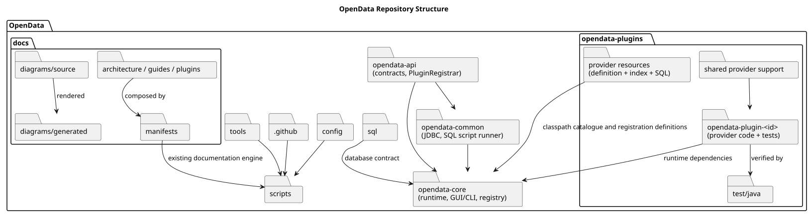

# Repository Structure

**Document ID:** DEV-REPOSITORY-001  
**Version:** 3.1.0  
**Status:** Version 3.1.0 modular build baseline  
**Baseline date:** 18 September 2026

---



## Top-level layout

| Path | Purpose |
|---|---|
| `opendata-api` | Shared plugin contracts, immutable configuration records, and database resource interfaces |
| `opendata-common` | Shared validation, JDBC helpers, shared exceptions, utility helpers, logging context, and reusable support code |
| `opendata-core` | Application entry points, runtime orchestration, plugin registry services, GUI/CLI, SQL Server resources, and the bundled plugins (code, `config/plugins/*.properties` definitions and `sql/plugins/*.sql` schema scripts) |
| `sql` | Ordered SQL Server installation, schemas, permissions and verification |
| `docs` | Authoritative Markdown, PlantUML, manifests, examples and templates |
| `config` | Documentation and code-quality configuration |
| `scripts` | Build, documentation, certificate, quality and release automation |
| `.github/workflows` | Build, documentation and release workflows |
| `tools` | Local third-party tool placement guidance |

## Module layout

Each Maven module uses the standard layout:

```text
src/main/java
src/main/resources
src/test/java
```

Tests must live with the module that owns the production code they verify.
`opendata-common` therefore owns the shared JDBC, validation, exception, and
reusable support tests, `opendata-core` owns application, plugin-registry and bundled plugin tests.

## Java ownership

The split source tree keeps one logical package namespace below
`com.towermarsh.opendata`, but package ownership is now module-specific:

- `opendata-api`: `config.model`, `database`, `plugin`
- `opendata-common`: `database`, `database.jdbc`, `download.strategy`, `exception`, `logging`, `util`, `validation`
- `opendata-core`: root/app entry points, runtime `config`, `database.audit`, `discovery`, `download`, `etl`, `gui`, `logging`, `model`, `parser`, and plugin-registry/orchestration classes in `plugin`
- `opendata-core` also owns the provider packages below `plugin.<plugin-id>`, each with `initialise`, `extract`, `transform`, `load`, `finalise` sub-packages and a `RegisterPlugin` class

Provider-specific code remains below:

```text
com.towermarsh.opendata.plugin.<plugin-id>
```

The provider plugin package structure remains:

```text
<plugin-id>
├── initialise
├── extract
├── transform
│   ├── model
│   └── validate
├── load
└── finalise
```

`docs/templates/plugin-java` is the structural template for new provider code.
`docs/examples/example-plugin` is a compact copyable API example including
registry and properties snippets. Neither tree is compiled by Maven, so example
changes require an explicit temporary compile check.
