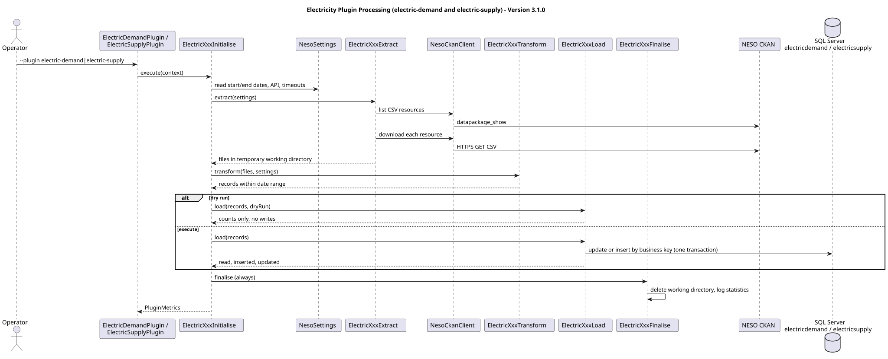
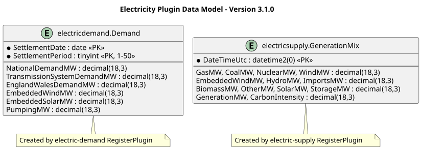

# Historical electricity plugins (Great Britain)

## Overview

Two independent OpenData plugins, `electric-demand` and `electric-supply`, load historical Great Britain datasets supplied by the National Energy System Operator (NESO). Each is a separate project under `opendata-plugins` (`opendata-plugin-electric-demand` and `opendata-plugin-electric-supply`) and neither depends on the other; shared NESO helpers live in `opendata-plugin-electricity-common`. Each follows the standard initialise, extract, transform, load, finalise steps. Northern Ireland is not covered.

## Installation

1. Build with Maven using the standard root reactor, which includes the provider projects and their shared support project.
2. Register `electric-demand` and `electric-supply` with the GUI **Register** or **Register from File** actions, or the CLI `--register`. Registration runs each plugin's `RegisterPlugin`, which creates the `electricdemand` and `electricsupply` schemas and tables from `sql/plugins/electric-demand.sql` and `sql/plugins/electric-supply.sql`. The SQL login therefore needs permission to create schemas and tables. Do not duplicate plugin ids when registering.
3. Run `opendata --plugin electric-demand --execute --dry-run` then `opendata --plugin electric-supply --execute --dry-run`. Finally run without `--dry-run`.

## Configuration

Both plugin `.properties` definitions include `start-date` and `end-date` (ISO yyyy-MM-dd, inclusive), `api.base-url`, `api.dataset-id`, and HTTP connection/request timeout seconds. All values are read from OpenData plugin definitions; no environment variables, JVM properties, secrets or API tokens are needed. Edit individual plugin properties to change ranges. Initial backfill defaults to **2009-01-01 through 2025-12-31**; extend end-date to import later years. NESO may revise older records: reruns update existing primary keys.

## Data definitions

**Demand:** one row per GB settlement date and settlement period. `ND` and `TSD` are different operational demand measures; do not add them. GB settlement periods can number 46, 48 or 50 during clock changes. SQL records settlement period instead of deriving a UTC timestamp. Other measures cover England/Wales demand, estimated embedded wind/solar and pumped storage demand. All power columns are MW (not MWh).

**Supply:** one row per NESO generation mix UTC timestamp, with fuel-category MW, imports MW, generation total and reported carbon intensity. Fuel totals and carbon intensity are sourced values, not derived. Embedded renewable figures are estimates. `OTHER` currently encompasses battery net discharge and transmission-connected solar; `STORAGE` represents pumped storage, according to NESO's dataset notes. The dataset applies corrections and seasonal processing; this is not a direct raw power station meter feed.





## Extraction and loading

Each plugin runs the standard steps:

| Step | Behaviour |
|---|---|
| Initialise | reads `start-date`, `end-date`, API and timeout properties and orchestrates the other steps |
| Extract | queries CKAN `datapackage_show`, selects the matching CSV resources and downloads them to a temporary working directory |
| Transform | parses the CSV files with Apache Commons CSV, validates and maps dates and numbers, and keeps rows inside the date range |
| Load | inserts or updates SQL Server rows by business key in one transaction; a failure rolls the whole load back. Dry runs report records as skipped and write nothing |
| Finalise | always runs: deletes the working directory and logs the statistics |

Reruns are idempotent. Empty numeric cells map to SQL NULL.

**Important operational notes:** Full-history generation mix CSVs can be large and may require several minutes and substantial bandwidth; initial import into SQL Server can be slow due to row-by-row upserts. Set the request timeout according to network behaviour. The supplied code assumes source CSV headers/CKAN metadata fields remain consistent; test against a recent file before scheduling production collection. If NESO changes resource layouts or canonical dataset identifiers, update the parser and property definition. The supplied package was not integration-tested against live NESO or a SQL Server instance in this environment.

## SQL checks

```sql
SELECT YEAR(SettlementDate) AS Year, COUNT(*) AS Intervals, AVG(NationalDemandMW) AS AverageDemandMW
FROM electricdemand.Demand GROUP BY YEAR(SettlementDate) ORDER BY Year;

SELECT YEAR(DateTimeUtc) AS Year, COUNT(*) AS Intervals, AVG(WindMW) AS AvgWindMW, AVG(GasMW) AS AvgGasMW
FROM electricsupply.GenerationMix GROUP BY YEAR(DateTimeUtc) ORDER BY Year;
```

## Provenance

- NESO Historic Demand: https://www.neso.energy/data-portal/historic-demand-data
- NESO Historic Generation Mix and Carbon Intensity: https://www.neso.energy/data-portal/historic-generation-mix
- NESO CKAN API: https://api.neso.energy/api/3/action/datapackage_show
- Always confirm current NESO Open Data Licence terms and preserve source attribution when publishing derived data.
